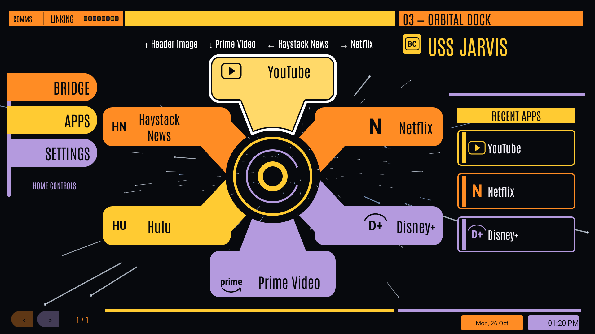
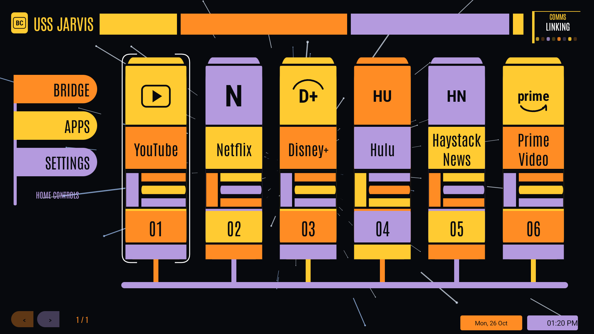
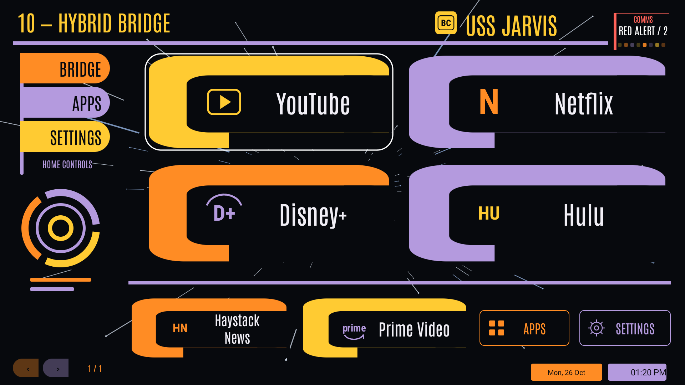

# Bridge Console TV

A free LCARS-inspired Android TV launcher. Early public preview.

**[Download page](https://firejackson1.github.io/bridge-console-tv/)** · **[APK and release notes](https://github.com/firejackson1/bridge-console-tv/releases)** · **[Report an issue](https://github.com/firejackson1/bridge-console-tv/issues)**

Ten LCARS layouts plus a classic layout, animated starfield backgrounds/screensaver, app organization and optional Home Assistant controls. Android TV 8.0 or newer; tested on onn 4K Pro.

Read installation instructions and development-signing migration notes on the download page. This repository hosts the public page and releases, not the development source history. No signing keys, credentials or device configuration are published here.

Support is optional. Use the PayPal button on the [download page](https://firejackson1.github.io/bridge-console-tv/#support) if you would like to support development.

Unofficial fan project; not affiliated with or endorsed by Star Trek or its owners. Antonio is licensed under the SIL Open Font License; see licenses/Antonio-OFL.txt. APK third-party notices accompany each release.

## All layouts

[View the complete native screenshot gallery](https://firejackson1.github.io/bridge-console-tv/#layouts). The ten LCARS layouts and classic bridge use an arranged set of separately installed media apps.

